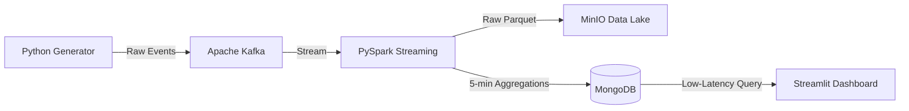

# Real-Time Order Analytics Pipeline

An end-to-end event streaming and analytics pipeline demonstrating how to ingest, process, and visualize high-throughput e-commerce transactions in real-time.

**🌐 Live Public Demo:** [https://share.streamlit.io/](https://share.streamlit.io/) (Portfolio Demo Mode)  
**🐙 GitHub Repository:** [https://github.com/jain6604/real-time-order-analytics-pipeline](https://github.com/jain6604/real-time-order-analytics-pipeline)

---

## 🎯 What This Project Does

This project simulates a real-world data engineering architecture. It generates e-commerce orders, streams them through an Apache Kafka message broker, processes them with PySpark Structured Streaming to compute tumbling window metrics, archives the raw data into a MinIO Data Lake, and serves ultra-low latency analytics to a web dashboard via MongoDB.

### 🎮 The Public Demo Experience
The live public deployment runs in a specialized **Demo Mode** designed for recruiters and portfolio visitors at zero cost. It operates independently of the local backend:
- Click **"Simulate New Orders"** to generate new interactive sample data on the fly.
- Filter data dynamically by **City** and **Product**.
- View interactive charts for Revenue Trends, Top Products, and City Contributions.
- Download a CSV of the filtered recent orders.
- The UI explicitly displays `DEMO MODE` to clarify that it is using simulated data without spinning up cloud clusters.

### ⚙️ The Local Live Pipeline
When you run the project locally, the dashboard automatically detects the backend and switches to **Live Pipeline** mode. It reads strictly from the MongoDB metrics collections powered continuously by PySpark and Kafka, proving the robust data platform architecture.

---

## 🏗️ Architecture & Tech Stack



- **Data Generation:** Python 3.12
- **Message Broker:** Apache Kafka (KRaft mode, no ZooKeeper)
- **Stream Processing:** PySpark Structured Streaming (3.5.3)
- **Serving Layer:** MongoDB (7.0) for fast aggregate queries
- **Data Lake (Cold Storage):** MinIO (S3-compatible object storage)
- **Visualization:** Streamlit
- **Orchestration:** Docker Compose
- **CI/CD:** GitHub Actions (Unit testing & Docker validation)

---

## 🚀 How to Run the Full Pipeline Locally

### Prerequisites
- Docker and Docker Compose installed.

### Steps
1. Clone this repository:
   ```bash
   git clone https://github.com/jain6604/real-time-order-analytics-pipeline.git
   cd real-time-order-analytics-pipeline
   ```
2. Copy the environment variables:
   ```bash
   cp .env.example .env
   ```
3. Start the entire infrastructure (Kafka, MinIO, MongoDB, Spark, Producer, and Dashboard):
   ```bash
   docker compose up --build -d
   ```
4. **View the Dashboard:** Open `http://localhost:8501`. You will see the green `LIVE PIPELINE` badge indicating data is flowing through Kafka and Spark into MongoDB.
5. **View the Data Lake:** Open `http://localhost:9001` (Login: `minioadmin` / `minioadmin`) to inspect the raw Parquet archives.

---

## 🧪 Tests and Quality Checks

This project maintains high engineering standards:
- **Unit Tests:** `pytest tests/` verifies order generation schemas and demo data calculations.
- **Continuous Integration (CI):** A GitHub Action runs on every push, validating Python syntax, unit tests, and Docker Compose configuration.
- **Idempotency & Resilience:** PySpark utilizes HDFS/S3 checkpoints to guarantee exactly-once processing semantics, while the MongoDB sink safely upserts windowed metrics to handle restarts gracefully.

## 📌 Future Enhancements
- Switch raw Parquet storage to Delta Lake for ACID transaction support in the Data Lake.
- Implement an explicit Dead Letter Queue (DLQ) in Kafka for malformed messages.
